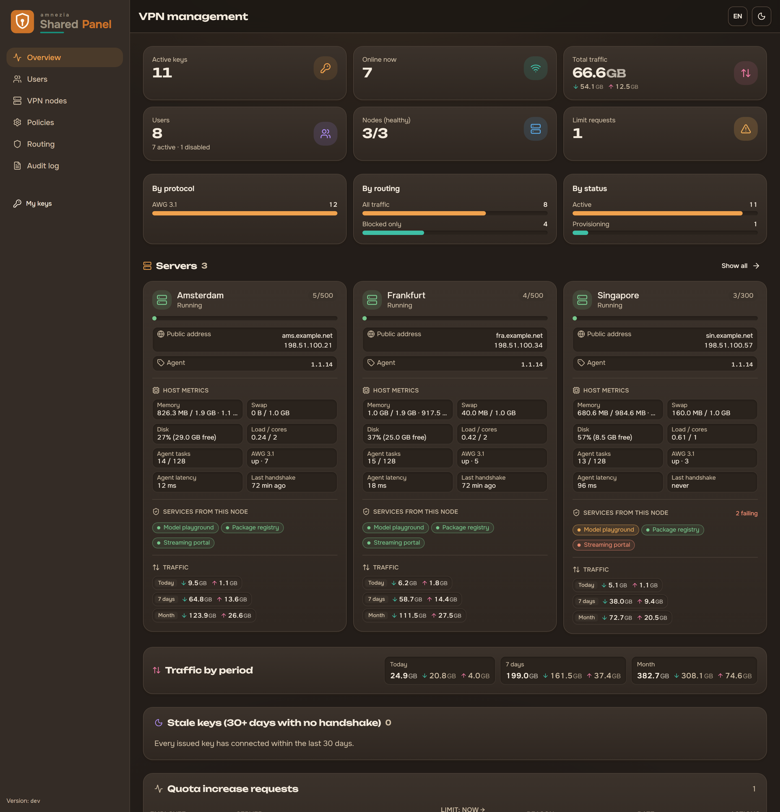
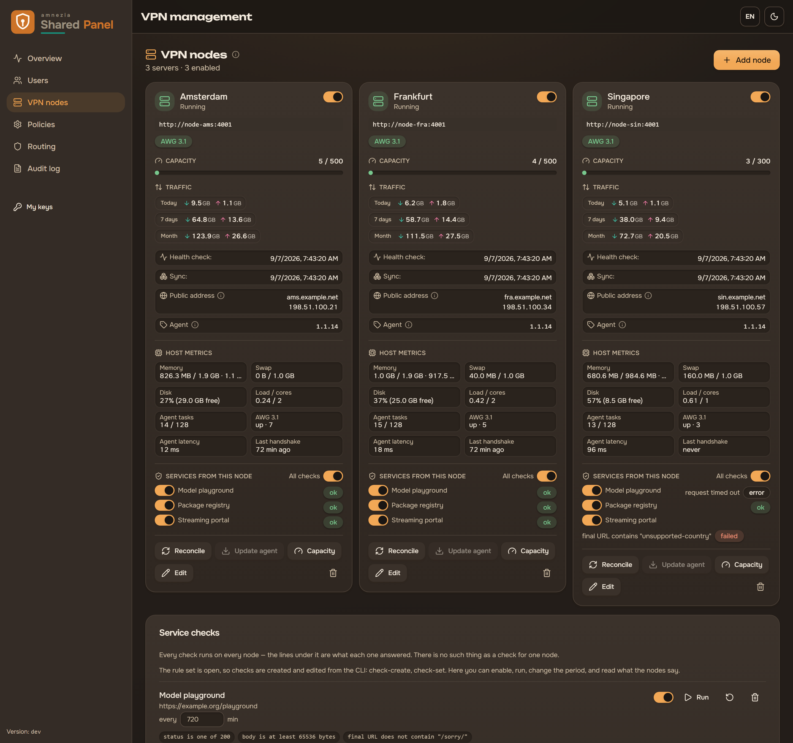
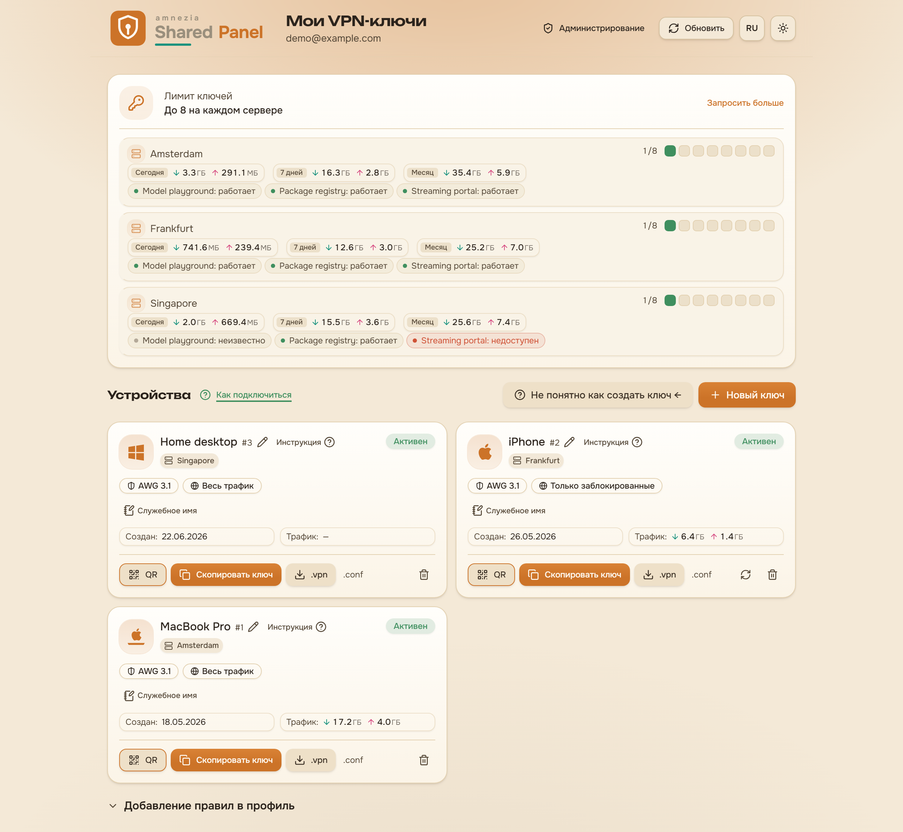
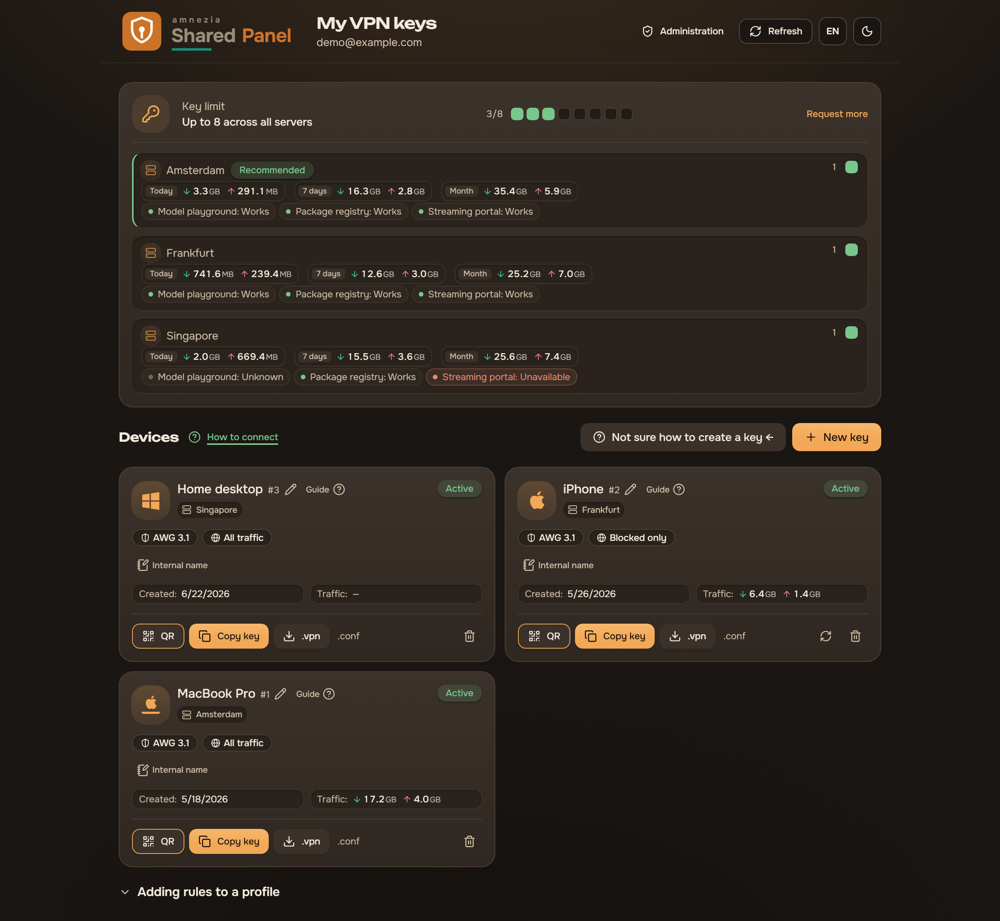
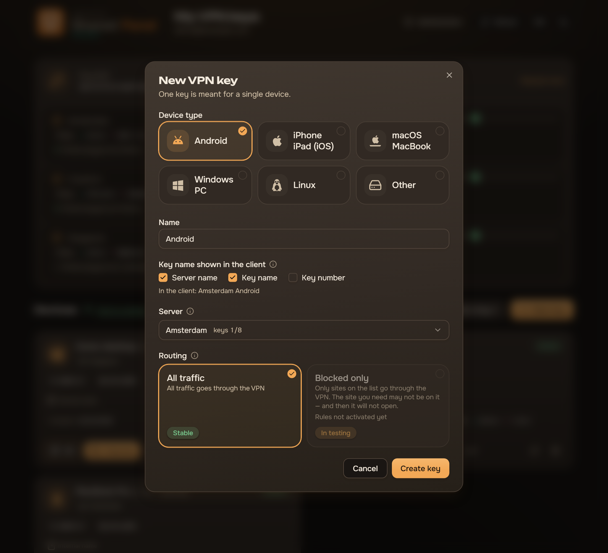
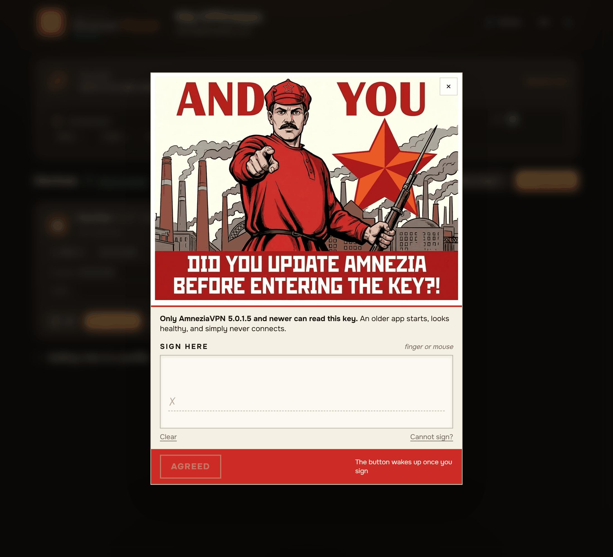

<div align="center">


**A self-hosted control plane for AmneziaWG VPN access.**
Employees create and manage their own device keys; admins manage users, nodes,
policy, and telemetry across one or more nodes — behind a login you control.

**English** · [Русский](README.ru.md)

[](https://github.com/wyrtensi/amnezia-shared-panel/actions/workflows/ci.yml)
[](https://github.com/wyrtensi/amnezia-shared-panel/releases)
[](https://github.com/wyrtensi/amnezia-shared-panel/releases)
[](https://t.me/+ACFiuWoI9Es2OGZi)
[](LICENSE)
[](#protocol)
[](https://nextjs.org)
[](docs/runbooks/AWG-BRIDGES.md)

</div>

## Overview

Handing out VPN configs by hand doesn't scale: every new device is a manual step,
revoking a departed teammate is fiddly, and nobody can see who's using what. Shared
Panel replaces that with self-service. A team member signs in, creates a key for a
specific device, and downloads a config or QR; an administrator sees every user,
their keys, traffic, and who's online, and can raise or cut limits or offboard
someone in a click.

The constraint it's built around: **the panel has to open even where the usual
front door is blocked.** Some people can't reach Cloudflare, and sometimes the VPN
itself isn't up yet — which is exactly when you need to get into the panel to fetch
a config. So sign-in works two independent ways at once — Cloudflare Access, and the
panel's own Google login on a direct, Cloudflare-free domain (see below).

Under the hood it's two halves that deploy independently. The **panel** — a Next.js
web app, a Fastify API, a worker, and Postgres — manages users, policy, and
telemetry and drives the nodes. A **node** is a VPN server running AmneziaWG 3.1
(which masks packet headers and adds random trailers, so the traffic is harder to
fingerprint and block) with a small agent the panel talks to. One panel, one or
more nodes, each updated on its own.

What that buys an operator, concretely:

- **Self-service keys.** A user picks a device and a server, gets a config, a
  `.conf` file or a QR code, and can rename or reissue a key without asking
  anyone. Each AWG 3.1 key has its own client-side junk parameters, and its
  owner can draw new ones with **Refresh config** without losing the key. Quotas are per server or a shared pool, per user or panel-wide.
- **Routing per key.** Full tunnel or Outside Runet (`ru_blacklist`,
  defaulting to **E-Core** `compact_world`: ~1,250 routes covering ~85% of non-RU
  IPv4 plus non-RU IPv6 with 0% RU/LAN/Apple/Valve AS32590 SteamCache overlap; or
  `blocked_only` at ~780 routes). The rule set is fetched, compacted, validated,
  and versioned by the panel so keys tell their owner when rules move on. Users
  can copy a `vpn://` key up to AmneziaVPN's paste limit or download a `.vpn`
  file. QR codes are available for full-tunnel keys. Admin
  `global_route_overrides` are baked into every refresh (and immediately mirrored
  at export via real CIDR subtraction), and `RULE_EXTRA_INCLUDE_URLS` /
  `RULE_EXTRA_EXCLUDE_URLS` layer custom CIDR lists on top of the defaults
  without replacing `RULE_FEEDS`.
- **Per-node IPv6 active-reject stub (ULA).** On IPv4-only AWG 3.1 nodes, each
  node card in `/admin/nodes` (and `amnezia-panel node-ipv6-stub`) provides an
  opt-in **IPv6 Reject (ULA)** switch (`fd6b:7c2e:4a91:9f::/64` + kernel
  `prohibit 2000::/3`, ICMPv6 Administratively Prohibited) so dual-stack iOS/Android
  clients and `.conf` exports fall back to IPv4 immediately via Happy Eyeballs
  instead of stalling on silent IPv6 blackholes — toggled cleanly on or off
  without dropping IPv4 sessions or touching desktop `vpn://` exports. Starting
  with `node-agent` `1.1.22`, the host updater (`scripts/agent-update.sh`) also
  enables the required IPv6 forwarding sysctls live inside `amnezia-awg3`'s
  network namespace via `nsenter` with zero AWG restart.
- **Multiple public IPv4 addresses per AWG 3.1 node.** One AWG 3.1 node can
  expose multiple independently named IPv4 endpoints (`node_vpn_endpoints`)
  sharing the same peer store, with per-IP server order (`endpointOrder`),
  per-IP global and per-user availability (`allowedEndpointIds`), independent
  enable/disable switches (including disabling the primary IP while a backup IP
  remains active), and per-IP reachability checks & alerts.
- **Service checks.** Named checks — a status code, a marker in the body, where a
  redirect lands — run from every node on a schedule, so "is this reachable from
  that country" is a row in the panel rather than an experiment.
- **External reachability probe & Telegram integration.** A small container on a
  machine in the network you care about brings up a real AWG tunnel to every node
  and public IPv4 listener (plus bridge hosts, FRP registrations, and bridge
  management health) each hour; `/admin/nodes` shows per-node, per-IP, per-protocol,
  and per-bridge verdicts with independent alert switches, and optional Telegram
  bot integration (`TELEGRAM_BOT_TOKEN` + `TELEGRAM_CHAT_ID`) delivers quota-request
  alerts, node/IP/bridge outage & recovery alerts (one message per incident), and
  a live pinned Telegram status widget, one shared widget in every listed chat
  (`sendWidget` with `is_shared`). See
  [docs/REACHABILITY-PROBE.md](docs/REACHABILITY-PROBE.md).
- **Fleet visibility.** Host metrics, agent version, peer counts and traffic per
  node and per key, with a one-command agent update that swaps only the agent
  container and never restarts a tunnel.
- **Optional AWG bridge.** A public bridge host can forward UDP to several AWG 3.1
  nodes, one port per node; node assignments live in **Policies → Node routes**
  under **Server order**. Users route through active bridges only when opted in
  globally (`useBridge`, off by default) or per user (`user-bridge`), and admins
  can override bridge routing per key (`inherit` / `direct` / pinned route) with
  admin-only route badges. Bridges also track optional panel DNS forwarding
  (`panelDns`). Native AWG 2 stays direct. See the
  [AWG bridge runbook](docs/runbooks/AWG-BRIDGES.md).
- **Offboarding that finishes.** Disabling an account revokes its keys on the
  nodes, and the panel refuses to delete a row while a peer might still exist —
  so a departed teammate leaves no peer behind.

## What it looks like

**Administration** — one overview with the numbers that matter, per-node capacity
and traffic, stale accounts, pending quota requests, and a one-click panel update.

<p align="center">
  
</p>

**Servers** — every node with what it is actually doing: the agent version it
reports, host metrics read from the machine rather than from its container,
whether each AmneziaWG interface is up and how many peers it carries, and the
verdict of every service check on that node. Checks run on every node, so a
service that answers in Amsterdam and refuses in Singapore shows up as a
difference between nodes rather than as a support ticket.

<p align="center">
  
</p>

**A team member's own page** — their devices, what each key routes, how much of
their quota is left on each server, and the extra routes they may layer on top.
Below it is the same screen twice: the UI ships English and Russian, follows the
browser language on first visit (the RU/EN switch is remembered afterwards) and
the system theme.

<table>
  <tr>
    <td width="50%"></td>
    <td width="50%"></td>
  </tr>
</table>

**Creating a key** takes one dialog: pick the device, name it, choose what the
AmneziaVPN client will show as the connection title, and pick how traffic is
routed. The preview under the checkboxes is built with the same function the API
uses at export time, so it cannot drift from the name the client actually gets.

**Connecting** is explained in the panel itself: the "How to connect" button in
the keys page header opens a guide that installs the AmneziaVPN client. It is
organised around one choice: the reader picks their device — Windows/macOS/Linux,
Android, or iPhone / iPad — and gets only that instruction, rather than scrolling
past advice for platforms they do not have. Each one walks through pasting a key, explains how to import a `.conf`
file — the easier route for split-tunnel profiles on a computer and on Android —
and lists what to try when a connection fails. It also states the one platform
caveat we know of: in the **Default VPN** app from the Russian App Store on iOS,
a key with a routing profile imports and connects but applies none of its rules
(whereas official AmneziaVPN on iOS applies routes normally when kept below the
iOS NetworkExtension route ceiling, which E-Core's ~1,250 routes satisfy). The
create-key wizard offers every profile on every platform because the panel cannot
tell which client a device runs; `amnezia-panel user-create-key --device-type=ios`
prints a warning and `amnezia-panel keys --needs-profile-warning` lists existing
pairs. The download links are not hardcoded:
`GET /api/client-releases` resolves the newest `amnezia-client` release on the
panel host, caches it for six hours, and falls back to version-free release-page
links when GitHub is unreachable, so a user on a network that cannot reach GitHub
still gets working buttons. The AmneziaWG 3.1 client floor is a single constant
in `packages/contracts`. Operators can inspect and force-refresh what the panel
resolves with `amnezia-panel client-releases [--refresh]` (see `docs/CLI.md`).

<p align="center">
  
</p>

**A stale client is the failure this panel sees most**, and it is silent: an
AmneziaVPN older than the AWG 3.1 floor starts, looks healthy, and never
connects, so the person concludes the panel is broken. Two steps answer it. The
first fires once, right after a key is created. The second is the poster below:
the first two times a regular user reaches for a finished key — the QR, the
clipboard, either config file — the panel stops and asks them to **sign** that
the app is up to date, and only then runs what they asked for. A signature
rather than a checkbox, because one reflex tap is exactly the failure a checkbox
does not prevent; there is a checkbox behind "cannot sign?" for keyboards and
screen readers, and closing the sheet runs nothing and spends no showing. The
two showings land on two separate occasions — a signature keeps the notice down
for ten minutes, so one sitting with a key is asked once. It is
deliberately the one surface in the panel that ignores the theme and the rounded
corners — it is a notice, not furniture. Administrators never see it, the
counter lives on the user row (so no cleanup can resurrect it), an operator can
show it again with `amnezia-panel user-notices-reset`, and
`policy-set --showUpdateNotice=false` switches it off panel-wide or per user.

<p align="center">
  
</p>

## Protocol

**This project targets AmneziaWG 3.1 as its primary protocol.** New nodes and new
keys should use AWG 3.1 (header protection, ranged headers, random trailers).
AmneziaWG 2.0 is retained only for backward compatibility with already-deployed
nodes and existing peers during the transition; do not build new features against
2.0. AWG 3.1 keys require the official AmneziaVPN client 5.0.1.5 or newer.

## Two ways users sign in

The panel is usable even where a working VPN or Cloudflare is unavailable — it
accepts either identity, side by side:

- **Cloudflare Access** — the edge injects a signed JWT the control-api verifies
  (Google Workspace as the IdP, an email/group allowlist at the edge).
- **Direct server-side Google** — for users who cannot reach Cloudflare, the panel
  serves itself on a DNS-only host with its **own** Google login and a signed
  session. See [`docs/INSTALL.md` §3.5](docs/INSTALL.md).

Roles live in the panel (`admin` / `user`); an admin is also a user (own keys
and quota). Two guards stop an admin from locking the panel out of every
administrator: an admin cannot offboard themselves (`SELF_OFFBOARD`) and
cannot demote or offboard the last active admin (`LAST_ADMIN`, checked on both
`users/set-role` and `users/offboard`) — see
`apps/control-api/src/postgresRepository.ts`. `BOOTSTRAP_ADMIN_EMAILS` is a
different mechanism (it seeds the first admin(s) on their first login) and
does not rescue anyone: `resolveIdentity` only ever promotes a matching
email's **role** to `admin`, never its `status`, and the request gate in
`apps/control-api/src/app.ts` still rejects a disabled actor with
`403 USER_DISABLED`. A bootstrap admin who has been disabled stays locked out
like any other disabled account.

## Workspace

- `apps/web` — employee and administrator web interface (Next.js).
- `apps/control-api` — authenticated central REST API (Fastify).
- `apps/worker` — provisioning, telemetry, retention, and routing jobs.
- `apps/cli` — admin CLI over the control-api ([`apps/cli/README.md`](apps/cli/README.md)).
- `packages/contracts` — shared public types and validation schemas.
- `packages/db` — PostgreSQL schema, migrations, and repositories.
- `packages/vpn-config` — AWG `vpn://` codec, endpoint rewriter, BigInt CIDR compaction engine, and IPv6 reject-stub ULA helper.
- `services/node-agent` — reviewed fork of `kyoresuas/amnezia-api`; the HTTP agent
  that fronts an AmneziaWG container on each node.
- `services/bridge-agent` — lightweight status and self-update agent for optional AWG 3.1 bridge hosts.
- `infra/dev` — local Docker Compose environment.
- `infra/prod` — production Compose stack (tiny-host, pulls the image from GHCR).
- `infra/node` — VPN-node deployment assets.
- `infra/bridge` — optional AWG 3.1 FRP bridge host assets.
- `infra/probe` — external reachability probe container and setup scripts.

Sensitive local material belongs in the git-ignored `secrets/` directory.

## Quick start (local dev)

Use Node.js 24 and pnpm 12.18.0, as pinned in `package.json`. Install or update
the package manager with `npm install --global pnpm@12.18.0`, then check
`pnpm --version`. Older JavaScript-based pnpm launchers may fail to bootstrap
the native pnpm 12 executable. To run the matching version without a global
installation, use `npm exec --package pnpm@12.18.0 -- pnpm <command>`.

```bash
pnpm install
cd infra/dev && docker compose --env-file .env up --build
```

The app comes up at `http://127.0.0.1:3000`. The dev stack sets a dev identity
(`DEV_USER_EMAIL`, default `admin@example.com`) so you sign in without Cloudflare
or Google. To run the services in watch mode without containers: `pnpm dev`.

Before pushing, run what CI runs: `pnpm lint && pnpm typecheck && pnpm build &&
pnpm --filter @amnezia/db db:migrate && pnpm -r --workspace-concurrency=1 --if-present test`
against a dedicated test database. Tests are serialized because integration
suites reset shared tables. Full command reference: **[`docs/CLI.md`](docs/CLI.md)**.

## Deploy & update (production)

The live host runs `infra/prod` and **pulls** the published image
`ghcr.io/<owner>/amnezia-shared-panel:latest`. Cutting a release = tag the public
repo `vX.Y.Z`; CI builds and pushes the image (the tag is stamped into
`GET /api/admin/version`). On the host, `bash infra/prod/update.sh` performs a
data-safe update (backup DB → pull → migrate → recreate; volumes untouched), and
the **Administration → Overview → Update** button does the same via a host systemd
worker after a one-time `sudo bash infra/prod/install-updater.sh`.

## Documentation

- **[`docs/INSTALL.md`](docs/INSTALL.md) — start here.** Install guide written for
  a human or an AI agent: what to decide first, then node + panel + public access
  (Cloudflare Access with Google Workspace, and the optional direct Google login),
  the temporary→least-privilege API-token hand-off, and the admin/user policy split.
- [`docs/OPERATIONS.md`](docs/OPERATIONS.md) — **which document owns which job**,
  and the day-2 procedures none of them cover: proving an update will not reset
  users' keys, moving the data plane to a new engine build, editing a generated
  config, swap and disk on a live node, and the panel→node tunnels.
- [`docs/CLI.md`](docs/CLI.md) — every command for the panel **and** a node
  (dev, build, database, deploy/update, backup, admin CLI; AmneziaWG/awg, Docker,
  node-agent, health).
- [`docs/HOSTING.md`](docs/HOSTING.md) — architecture, identity model, credential
  types, secrets, end-to-end hosting.
- [`docs/AGENT-HOST-SETUP.md`](docs/AGENT-HOST-SETUP.md) — install a fresh AWG host
  and wire it to the panel.
- [`docs/NODE-CONNECT.md`](docs/NODE-CONNECT.md) — register and reach a live node
  (SSH tunnel or direct TLS) and its safety constraints. `scripts/add-node.sh`
  does the whole rollout — bare host to registered node — in one command.
- [`docs/CLOUDFLARE-SETUP.md`](docs/CLOUDFLARE-SETUP.md) / [`docs/CLOUDFLARE-ACCESS.md`](docs/CLOUDFLARE-ACCESS.md)
  — the tunnel + Google login, and the Access app / allowlist / two-way sync.
- [`docs/DEPLOY-UPDATE.md`](docs/DEPLOY-UPDATE.md) · [`docs/UPDATE-MECHANISM.md`](docs/UPDATE-MECHANISM.md)
  — updating the stack from git, and the in-panel Update button internals.
- [`docs/runbooks/AWG-BRIDGES.md`](docs/runbooks/AWG-BRIDGES.md) — optional AWG 3.1
  bridges: add, validate, assign, user opt-in policy, per-key routing, switch back, retire, rollback preflight.
- [`docs/REACHABILITY-PROBE.md`](docs/REACHABILITY-PROBE.md) — external reachability
  probe, Telegram outage/quota notifications, and the pinned Telegram status widget.
- [`docs/IPV6-DESIGN.md`](docs/IPV6-DESIGN.md) — shipped IPv6 active-reject ULA stub
  and design draft for future full NAT66 / IPv6 node endpoints.

## License

Released under the MIT License — see [`LICENSE`](LICENSE).

`services/node-agent` is a fork of
[`kyoresuas/amnezia-api`](https://github.com/kyoresuas/amnezia-api) (MIT), and the
project builds on the AmneziaWG / Amnezia VPN ecosystem. Third-party attributions
and the licenses of notable dependencies are listed in [`NOTICE.md`](NOTICE.md).
